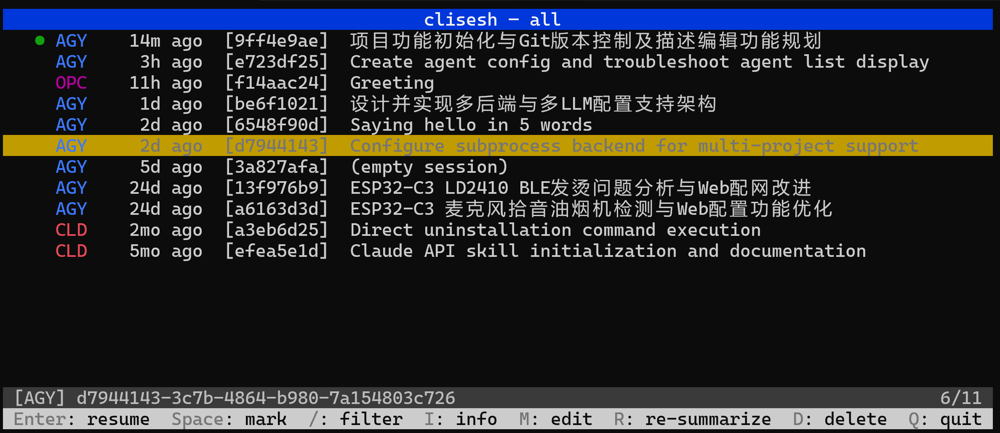

# clisesh

[](https://github.com/semigodking/clisesh/actions/workflows/ci.yml)
[](https://github.com/semigodking/clisesh/actions/workflows/release.yml)
[](https://github.com/semigodking/clisesh/releases)

English | [简体中文](README.zh-CN.md)

`clisesh` is a terminal UI designed to help developers **quickly find and restore previous agent CLI working environments**. If you frequently juggle multiple long-running tasks across different AI agent CLIs (Kiro, Antigravity, Claude Code, Codex, OpenCode, etc.), `clisesh` aggregates all your active and historical sessions in one place, lets you instantly search through them with AI-generated task summaries, and seamlessly resumes your workflow with a single keystroke.

By fully unlocking the value of historical sessions, `clisesh` eliminates redundant prompt context setup, boosting development efficiency while significantly reducing token consumption.



## Features

- **Unified Session Hub**: Aggregates sessions across **Kiro**, **Antigravity (`agy`)**, **Claude Code**, **OpenAI Codex**, and **OpenCode** in a single, newest-first view.
- **Smart AI Summaries**: Automatically generates concise task summaries using your preferred local CLI or cloud LLM backend. Press `m` on any session to manually edit, customize, or override descriptions on the fly.
- **One-Key Resume**: Select any session and press `Enter` to seamlessly take over and restore the CLI environment right where you left off.
- **Active Session Safety**: Automatically detects active running sessions with a lock indicator (`●`) and protects them against accidental deletion.
- **Real-Time Filtering & Batch Operations**: Quick search across titles, descriptions, and session IDs with `/`. Multi-select sessions with `Space` for batch operations.

## Supported Providers

`clisesh` discovers and aggregates installed agent CLIs automatically (`provider = "all"`).

| Provider | ID | Resume Command | Active Protection |
| :--- | :--- | :--- | :--- |
| **Kiro** | `kiro` | `kiro-cli chat --resume-id <id>` | ✅ Auto-detected (`●`) |
| **Antigravity** | `antigravity` / `agy` | `agy --conversation <id>` | ✅ Auto-detected (`●`) |
| **Claude Code** | `claude` | `claude --resume <id>` | ✅ Auto-detected (`●`) |
| **OpenAI Codex** | `codex` | `codex resume <id>` | ✅ Auto-detected (`●`) |
| **OpenCode** | `opencode` | `opencode --session <id>` | ✅ Auto-detected (`●`) |

> You can launch `clisesh` for a specific provider using `--provider <id>` or by setting `provider = "..."` in the configuration file.

## Installation

### Download Pre-built Binaries (Recommended)

Download the archive for your operating system and architecture directly from the [GitHub Releases](https://github.com/semigodking/clisesh/releases) page:
- **Linux**: `x86_64` (amd64) or `arm64`
- **macOS**: Apple Silicon (`arm64`) or Intel (`amd64`)

Extract the archive and move `clisesh` into your `PATH`:
```bash
tar -xzf clisesh_*.tar.gz
sudo mv clisesh /usr/local/bin/
```

### Build from Source

Requires Go 1.22+.

```bash
git clone https://github.com/semigodking/clisesh
cd clisesh
make build          # produces bin/clisesh (static binary)
```

## Quick Start & Usage

```bash
clisesh                       # Launch TUI aggregating all providers (default)
clisesh tui --provider kiro   # Launch TUI for a specific provider
clisesh list --provider all   # List sessions (non-interactive, scriptable)
clisesh summarize [id...]     # Pre-generate summaries in background
clisesh config init           # Generate default configuration file (~/.config/clisesh/config.toml)
clisesh version               # Print version
```

### Keyboard Shortcuts

| Key | Action | Description |
| :--- | :--- | :--- |
| `↑` / `k`, `↓` / `j` | Navigate | Move cursor up / down |
| `g` / `home`, `G` / `end` | Jump | Move to top / bottom of list |
| `pgup` / `pgdown` | Scroll | Page up / down |
| `space` | Mark | Toggle multi-selection for batch operations |
| `enter` | Resume | Resume selected session in its agent CLI |
| `m` | Edit | Manually edit description in a modal dialog |
| `r` | Re-summarize | Queue selected session(s) for re-summarization |
| `d` | Delete | Delete session (active `●` sessions are protected) |
| `i` | Info | View session details (ID, age, CWD, provider) |
| `e` | Error | View detailed error logs if summarization fails |
| `/` | Filter | Search across titles, descriptions, and IDs (`esc` to cancel) |
| `q` / `ctrl+c` | Quit | Exit clisesh |

## Configuration

`clisesh` works out of the box with zero configuration. To customize its behavior, generate a configuration file:

```bash
clisesh config init
```

Configuration is loaded from `~/.config/clisesh/config.toml` (or `$XDG_CONFIG_HOME/clisesh/config.toml`).

### Example Configuration

```toml
# Active provider: "all" (default), "kiro", "antigravity", "claude", "codex", or "opencode"
provider = "all"

# Color theme: "default", "gray", "high-contrast", or "256"
theme = "default"

[summarizer]
# Subprocess CLI backend (e.g. "subprocess.kiro", "subprocess.agy")
# or HTTP LLM backend (e.g. "llm.openai", "llm.deepseek", "llm.glm")
backend = "subprocess.kiro"
batch_size = 5                   # Concurrent background summarization workers

[summarizer.subprocess.kiro]
command = "kiro-cli"
args = ["chat", "--no-interactive", "--model", "{model}", "--effort", "low", "--wrap", "never", "{prompt}"]

[summarizer.llm.openai]
base_url = "https://api.openai.com/v1"
api_key = "${OPENAI_API_KEY}"
model = "gpt-4o-mini"
rpm = 60                         # Max requests per minute limit
```

> See [`configs/config.example.toml`](configs/config.example.toml) for all available options, including custom color overrides, token extraction settings, and LLM backends.

## Documentation & Development

- [Design Overview](docs/DESIGN.md) — Architecture and component design
- [Provider Capability Matrix](docs/providers/capability-matrix.md) — On-disk layouts and capabilities
- [Component Specifications](docs/specs/) — Detailed specs per module

```bash
make test     # Run unit tests
make lint     # Run code formatting and vet checks
make dist     # Cross-compile release archives for Linux & macOS
```

## Donation

If you think this software is helpful, consider to donate.

- 
- [Paypal](paypal.me/redsocks2)

## License

MIT
